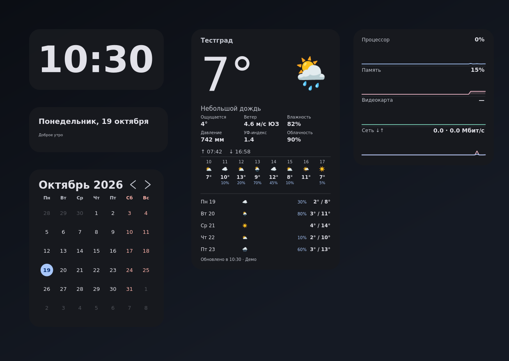

# PixelDesk

  

**PixelDesk** — виджеты рабочего стола в стиле **Google Pixel (Material You)** для
Windows 10/11. Часы, дата, календарь, погода и монитор системы живут прямо на
рабочем столе полупрозрачными карточками: их можно перетаскивать, растягивать,
менять масштаб и прозрачность. Программа живёт в трее и не загромождает панель задач.

- Автор: **Artur (artur0vi4)** → [github.com/artur0vi4](https://github.com/artur0vi4)
- Лицензия: MIT
- Платформа: Windows 10/11 (на Linux/macOS запускается в урезанном виде)

## Виджеты

| Виджет | Что показывает |
|---|---|
| **Часы** | Крупное время в 24-часовом формате, шрифт сам заполняет карточку |
| **Дата** | День недели, число, месяц + приветствие («Доброе утро»…). Шрифт растёт вместе с карточкой |
| **Календарь** | Текущий месяц, навигация стрелками, сегодня — в акцентном круге |
| **Погода** | Ощущается как, ветер, влажность, давление, УФ-индекс, облачность, восход/закат, 8 часов по часам, 5 дней вперёд |
| **Загрузка системы** | CPU (+ температура), RAM, GPU с температурой (NVIDIA и AMD/Intel), сеть ↓↑ с живыми графиками за минуту |

## Скачивание (автономный exe, Python не нужен)

1. Откройте раздел **[Releases](https://github.com/artur0vi4/PixelDesk/releases)**.
2. Скачайте `PixelDesk.exe` из последнего релиза.
3. Запустите — иконка появится в трее (возле часов), виджеты — на рабочем столе.

> ⚠️ Windows SmartScreen может предупредить о неизвестном издателе (exe без
> подписи). Нажмите **«Подробнее» → «Выполнить в любом случае»**.

exe собирается автоматически на GitHub Actions из исходников этого репозитория.

## Запуск из исходников (нужен Python)

1. Установите Python 3.10+ с [python.org](https://www.python.org/downloads/)
   — при установке отметьте галочку **«Add python.exe to PATH»**.
2. Двойной клик по **`run.bat`**. При первом запуске скрипт проверит библиотеки
   и сам предложит их установить (один раз, нужен интернет, ~2–5 минут) —
   нажмите **Y** и Enter.
3. Виджеты появятся на рабочем столе, иконка — в трее.

## Сборка exe самостоятельно

1. Убедитесь, что Python установлен (см. выше).
2. Двойной клик по **`build_exe.bat`**.
3. Через 2–5 минут готовый файл появится в **`dist\PixelDesk.exe`** — он работает
   на любом компьютере с Windows 10/11 **без Python**.

## Как пользоваться

**Перетаскивание** — зажмите виджет мышью и тащите.

**Растягивание** — потяните за правый-нижний угол карточки; шрифты подстраиваются
под новый размер.

**Масштаб** — три способа:
- `Ctrl + колесо мыши` над виджетом;
- правый клик → **Масштаб** → 70…200 %;
- шрифт всегда масштабируется вместе с карточкой.

**Правый клик по виджету** — меню:
- «Поверх всех окон» — вкл/выкл (по умолчанию виджеты всегда наверху);
- «Прозрачность» — 50…100 %;
- «Масштаб»;
- «Сменить город…» и «Источник погоды» (у погоды);
- «Скрыть виджет».

**Иконка в трее** (левый клик или правый клик):
- Скрыть/показать все виджеты;
- «Виджеты» — включение/выключение каждого по отдельности;
- «Тема» — 6 палитр Material You (Синий, Sage, Песочный, Лавандовый, Розовый, Океан) + тёмная/светлая;
- «Автозапуск с Windows» — включить/выключить старт программы при загрузке;
- «Обновить погоду»;
- «О программе»;
- «Выход».

## Погода

- **Три источника с автоматическим выбором** (меню виджета → «Источник погоды»):
  1. **Open-Meteo** — без ключа (по умолчанию);
  2. **MET Norway (yr.no)** — без ключа, надёжно работает в РФ;
  3. **Яндекс Погода** — нужен бесплатный ключ. Получите на
     [yandex.ru/dev/weather](https://yandex.ru/dev/weather/) (50 запросов/день),
     затем: правый клик по виджету → **«Ключ Яндекс Погоды…»**. Интервал
     обновления при этом автоматически поднимается до 30 минут.
- В режиме «Авто» виджет пробует источники по цепочке, пока один не ответит.
  Внизу карточки видно, какой источник ответил: «Обновлено в 14:05 · MET Norway».
- Город определяется **автоматически по IP** (3 сервиса с резервами); затем
  можно сменить: правый клик → «Сменить город…» (3 геокодера с резервами).
- Обновление — каждые 15 минут. При ошибке сети будет указано, от какого
  времени показаны данные.

## Мониторинг GPU и температур

Загрузка видеокарты:
1. **NVIDIA** — через `nvidia-smi` (показывает % и температуру).
2. **AMD / Intel / прочие** — через счётчики производительности Windows
   «GPU Engine» (Windows 10 1803+).

Температуры (CPU в строке «Процессор», GPU в строке «Видеокарта»):
1. **NVIDIA** — температура GPU через `nvidia-smi`.
2. **LibreHardwareMonitor / OpenHardwareMonitor** — если программа запущена,
   виджет сам подхватит из неё температуру CPU **и** GPU (рекомендуется
   для точных температур, особенно AMD).
3. **MSAcpi_ThermalZoneTemperature** (датчик материнской платы) — без
   дополнительных программ; на части плат требует запуск от администратора.
4. Если температуру определить не удалось — показывается только %.

> Совет: для гарантированных температур на любом железе установите
> [LibreHardwareMonitor](https://github.com/LibreHardwareMonitor/LibreHardwareMonitor/releases)
> и просто держите его запущенным (можно свернуть).

## Файлы настроек

`%APPDATA%\PixelDesk\config.json` — позиции, размеры, масштаб, тема, город.
Настройки из старой версии (`%APPDATA%\PixelWidgets`) переносятся автоматически.
При проблемах папку можно удалить — всё создастся заново.
Там же лежит `error.log` — если что-то пошло не так, загляните туда.

## Решение проблем

| Проблема | Решение |
|---|---|
| **После запуска bat ничего не происходит** | 1) Убедитесь, что у вас свежая версия репозитория. 2) `Win+R` → `cmd` → `py --version` — Python установлен? 3) Откройте cmd, перетащите `run.bat` в окно и нажмите Enter — ошибка будет видна |
| Скрипт пишет «Python not found», хотя `py --version` работает | Закройте все окна, откройте cmd заново и запустите bat из него, либо один раз перезагрузите ПК. Скрипт ищет Python также в реестре и папках установки; при провале покажет блок diagnostics — пришлите его скриншот |
| Ошибка на шаге установки библиотек | Проверьте интернет и запустите снова; корпоративный VPN/прокси может блокировать pypi.org |
| exe не открывается, SmartScreen | «Подробнее» → «Выполнить в любом случае» |
| Антивирус ругается на exe | Добавьте в исключения — ложное срабатывание PyInstaller-упаковки |
| Погода: «Нет сети» | Проверьте интернет; в режиме «Авто» источник подбирается сам (Open-Meteo → MET Norway → Яндекс) |
| Погода показывает не ваш город | Правый клик по виджету → «Сменить город…» |
| Видеокарта «—» | Для NVIDIA обновите драйвер; для AMD нужен Windows 10 1803+ |
| Виджеты пропали | Ищите иконку в трее → левый клик |
| Первый запуск exe «думает» 5–15 секунд | Нормально для onefile-упаковки — распаковывается в память |

## Авторство

- **Автор и разработчик:** Artur ([artur0vi4](https://github.com/artur0vi4))
- Дизайн — система **Material You** (Google Pixel); программа не связана с Google.
- Источники погоды: [Open-Meteo](https://open-meteo.com/),
  [MET Norway / yr.no](https://www.met.no/), Яндекс Погода (по ключу пользователя).

## Лицензия

[MIT](LICENSE) — свободно используйте, изменяйте и распространяйте.
